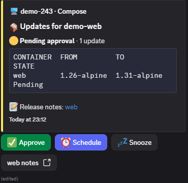

# ddum: Discord Docker Update Manager

Review, approve, deploy and roll back Docker image updates across your hosts, from Discord.

> **Public beta.** ddum's agent has the Docker socket, so it has root access to the host it runs on. Read the [security guide](docs/security.md) before you install it.



## What it does

- Checks your containers' registries for new versions, on a schedule or when you ask.
- Posts each update to a private Discord channel, with Approve, Schedule and Snooze buttons.
- Deploys only what you approve, using the exact image you approved, and checks the new containers are running before it reports success.
- Rolls back in one click, using the image it kept from before the update.
- Works with Docker Compose stacks and with Portainer.

Nothing updates automatically unless you turn on an automatic policy for it.

## What you need

- A Linux host with Docker and the Compose plugin, on amd64 or arm64.
- A Discord server you can manage, with a private channel for ddum.
- Either Compose stacks kept on the host, or Portainer.

## Automatic updates

Updates are manual by default. You can let a stack, a host or a single container update itself, with a policy:

```
/policy set scope:stack target:<stack> mode:automatic
```

- **`automatic`** deploys new versions as they're found. Each automatic deploy is verified, and rolled back if the new containers don't come up healthy.
- **`manual`** (the default) waits for you to approve.
- **`ignore`** never checks or updates it. A container can also be left out with the label `ddum.ignore=true`.

A policy can be set for everything, or for one host, stack, group or container. Each one inherits the setting above it unless it has its own, and `/policy show` says where each setting came from.

If an automatic update fails and is rolled back, ddum doesn't retry that version. It waits for you, and a newer release deploys automatically again.

## Groups

Some containers only work when they're updated together, such as an app and its database in two stacks. Put them in an update group, and ddum approves, deploys and rolls them back as one:

```
/group create name:<name>
/group add group:<name> container:<container>
```

You can also label each container with `ddum.group=<name>`. A group stays on one host. An automatic group only deploys when every member is set to automatic.

## Setup

1. Create a Discord bot, invite it to your server, and make a private channel for it. [Full steps](docs/operator-guide.md#discord).
2. Copy [`example.env`](example.env) to `.env`, and fill in your Discord IDs and token. Generate the two keys as the file says.
3. Copy [`compose.example.yaml`](compose.example.yaml) to `compose.yaml`, next to `.env`.
4. Start it: `docker compose up -d`
5. In Discord, approve the new host.
6. Run `/update check`, and approve an update to see it through.

The files are the full reference. A minimal version looks like this:

```yaml
# compose.yaml (excerpt)
services:
  ddum-bot:
    image: ghcr.io/dragondrew/ddum-bot:0.10.0
    environment:
      DISCORD_TOKEN: ${DISCORD_TOKEN}
      DISCORD_APPLICATION_ID: ${DISCORD_APPLICATION_ID}
      DISCORD_GUILD_ID: ${DISCORD_GUILD_ID}
      NOTIFICATION_CHANNEL_ID: ${NOTIFICATION_CHANNEL_ID}
      AUTHORIZED_DISCORD_IDS: ${AUTHORIZED_DISCORD_IDS}
      AGENT_SHARED_KEY: ${AGENT_SHARED_KEY}
    volumes:
      - ddum-bot-data:/data

  ddum-agent:
    image: ghcr.io/dragondrew/ddum-agent:0.10.0
    environment:
      BOT_URL: http://ddum-bot:8080
      AGENT_SHARED_KEY: ${AGENT_SHARED_KEY}
      AGENT_ID: ${AGENT_ID}
    volumes:
      - /var/run/docker.sock:/var/run/docker.sock
      - ddum-agent-data:/data
```

```sh
# .env (excerpt)
DISCORD_TOKEN=your-bot-token
DISCORD_APPLICATION_ID=your-application-id
DISCORD_GUILD_ID=your-server-id
NOTIFICATION_CHANNEL_ID=your-private-channel-id
AUTHORIZED_DISCORD_IDS=your-user-id
AGENT_SHARED_KEY=output-of-openssl-rand-hex-32
AGENT_ID=output-of-ddum-agent-gen-id
```
## Documentation

- [Operator guide](docs/operator-guide.md): hosts, Portainer, Compose stacks, backups, upgrading
- [Security guide](docs/security.md): what ddum protects, and a hardening checklist
- [Troubleshooting](docs/troubleshooting.md): what to do when something goes wrong
- [Changelog](CHANGELOG.md): what changed in each release

## Contributing and security

Report security problems privately, as [SECURITY.md](SECURITY.md) explains. To contribute, see [CONTRIBUTING.md](CONTRIBUTING.md).

## Licence

Apache 2.0. See [LICENSE](LICENSE) and [NOTICE](NOTICE). ddum isn't affiliated with or endorsed by Discord or Docker.
